# Architecture of CoC Macro

CoC Macro is a lightweight Windows desktop application written in Python (Tkinter) that automates the *search → evaluate loot → attack → surrender* loop in Clash of Clans running inside **Google Play Games for PC**. The application runs completely in the background without stealing keyboard or mouse focus, supports multi-account concurrent automation across multiple emulator instances, and provides automated base maintenance (upgrading walls or lowest-cost structures between attacks).

---

## 1. System Overview and Diagram

The system is organized into distinct functional layers:
- **Presentation & Interaction**: Tkinter multi-tab GUI, click-through transparent calibration overlay, pure viewmodel formatting, and global hotkeys.
- **Bot State Machine & Logic**: FSM managing the attack cycle, village upgrades, and storage monitoring.
- **Backend Protocol Abstraction**: Decouples high-level bot actions from operating system calls and computer vision operations.
- **Computer Vision & OCR**: Template matching, nearest-neighbor digit recognition via pre-trained glyphs, and HSV color analysis.
- **Win32 OS Interop**: Background screen capture (`PrintWindow`), mouse/wheel event injection (`PostMessage`), and multi-instance input arbitration.
- **Configuration & Storage**: JSON configuration, multi-account registry, recordings, and default calibration assets.

```mermaid
flowchart TD
    subgraph UI ["GUI & User Interaction"]
        GUI["gui.py (App & AccountPanel)"]
        VM["viewmodel.py (Pure state formatting)"]
        THEME["theme.py (Styles & widgets)"]
        OVERLAY["overlay.py (Click-through Tk overlay)"]
        HOTKEYS["hotkeys.py (pynput global F8/F9)"]
        MAIN["__main__.py / __init__.py"]
    end

    subgraph CORE ["Bot State Machine & Decisions"]
        BOT["bot.py (Bot FSM thread)"]
        DEC["decisions.py (Pure attack/surrender rules)"]
        UPG["upgrades.py (Walls & busy builder routines)"]
    end

    subgraph BACKEND ["Backend Abstraction"]
        GAME["game.py (RealGame : bot.Game protocol)"]
    end

    subgraph VISION ["Vision, OCR & Templates"]
        OCR["ocr.py (Connected components digit reader)"]
        VIS["vision.py (HSV storage bars & counters)"]
        TPL["templates.py (Normalized cross-correlation)"]
        GLYPHS[("glyphs.npz & counter_zero.npz")]
    end

    subgraph INPUT ["Input Replay & Calibration"]
        PLAYER["player.py (Gesture-level replay)"]
        REC["recorder.py (Mouse event recorder)"]
        CAL["calibrate.py (Interactive calibration)"]
    end

    subgraph OS ["Win32 OS Interop"]
        WINCTL["winctl.py (PrintWindow, PostMessage, WM_ACTIVATE)"]
        FRAMES["frames.py (1296px reference rescaling)"]
        GEOM["geometry.py (Relative 0..1 to pixel conversion)"]
    end

    subgraph DATA ["Storage, Config & Lifecycle"]
        CFG["config.py (Config dataclass & JSON)"]
        ACC["accounts.py (Multi-account registry)"]
        DEF["defaults.py (Shipped 16:9 calibration)"]
        PATHS["paths.py (data/ directory resolver)"]
        UPD["updater.py (GitHub releases updater)"]
        PRE["preflight.py (Launch sanity checks)"]
        DISK[("data/ directory: config, templates, recordings")]
    end

    MAIN --> GUI
    GUI --> VM
    GUI --> THEME
    GUI --> OVERLAY
    GUI --> HOTKEYS
    GUI --> BOT
    GUI --> CAL
    GUI --> REC
    GUI --> PRE
    GUI --> UPD

    BOT --> DEC
    GUI --> GAME
    GAME --> UPG
    GAME --> PLAYER
    GAME --> TPL
    GAME --> OCR
    GAME --> VIS
    GAME --> FRAMES
    GAME --> WINCTL

    UPG --> VIS

    PLAYER --> WINCTL
    REC --> GEOM
    CAL --> FRAMES
    CAL --> TPL
    CAL --> GEOM

    FRAMES --> WINCTL
    OCR --> GLYPHS
    VIS --> OCR

    CFG --> DISK
    ACC --> DISK
    DEF --> DISK
    PATHS --> DISK
```



---

## 2. Module Groups

The codebase in `cocmacro/` is divided into cohesive module groups. Every module in `cocmacro/*.py` is documented below.

### 2.1 Window Control and Capture
- **`cocmacro/winctl.py`**: Direct Win32 interop using `ctypes` (`user32`, `gdi32`, `kernel32`).
  - *Window Discovery (`winctl:list_game_windows`, `winctl:find_game_window`, `winctl:pick_window`)*: Discovers Google Play Games PC emulator windows by matching process name `crosvm` and window title prefix `Clash of Clans`. Returns immutable `GameWindow` or `WindowInfo` structs containing window handles (`hwnd`) and client dimensions.
  - *Background Capture (`winctl:capture`)*: Obtains BGR frames directly from the client area using `user32.PrintWindow(win.hwnd, mem, 2)` (`PW_RENDERFULLCONTENT`). This captures the game canvas even when obscured or placed behind other desktop windows.
  - *Minimized Window Recovery (`winctl:restore_if_minimized`)*: A minimized window has a `0x0` client area and fails capture. It is detected via `user32.IsIconic` and restored using `user32.ShowWindow(win.hwnd, SW_SHOWNOACTIVATE)` and positioned at `HWND_BOTTOM` (`SWP_NOACTIVATE | SWP_NOSIZE | SWP_NOMOVE`), ensuring the window becomes captureable without stealing foreground focus.
  - *Input Injection (`winctl:post_mouse`, `winctl:post_wheel`)*: Sends `WM_LBUTTONDOWN`, `WM_LBUTTONUP`, and `WM_MOUSEMOVE` directly to the window using client coordinates via `PostMessageW`. Wheel scrolling (`WM_MOUSEWHEEL`) translates relative coordinates into screen coordinates.
  - *Pointer Jiggle (`winctl:hover_to`)*: Google Play Games drops clicks if the cursor position has not changed since the preceding event. Before clicking, `hover_to` injects an offset hover event (`HOVER_STEP = 0.004`, ~4 px) followed by a hover at the target position.
  - *Multi-Instance Arbitration (`winctl:activate_instance`, `winctl:_input_lock`, `winctl:exclusive_input`)*: Multiple Clash of Clans windows in Google Play Games share a single underlying `crosvm` host input channel. The host forwards posted input solely to whichever instance is currently marked active. `activate_instance` delivers `WM_ACTIVATE` (`WA_ACTIVE`) to the target window and `WA_INACTIVE` to other game windows (`CROSVM_1` class) via `SendMessageTimeoutW` with `SMTO_ABORTIFHUNG`, allowing multiple accounts to run concurrently.
- **`cocmacro/frames.py`**: Frame normalization.
  - *Reference Rescaling (`frames:normalize`, `frames:grab`)*: The visual templates and OCR glyphs were captured at a reference client width of 1296 px (`REF_W = 1296`). When the client window is resized, `frames.grab` captures the frame and rescales it to 1296 px width using `cv2.INTER_AREA` (if downscaling) or `cv2.INTER_CUBIC` (if upscaling), ensuring consistent template matching and OCR across different window sizes.
- **`cocmacro/geometry.py`**: Coordinate conversions.
  - *Relative Coordinates (`geometry:to_px`, `geometry:to_rel`, `geometry:aspect`, `geometry:rect_to_px`)*: Translates between normalized relative coordinates `(0.0 - 1.0)` and integer client pixel coordinates `(x, y)` based on client width and height.

### 2.2 Vision, OCR, Glyphs, and Templates
- **`cocmacro/templates.py`**: Template matching engine.
  - *Normalized Cross-Correlation (`templates:score`, `templates:match`)*: Evaluates template matches using `cv2.matchTemplate(..., cv2.TM_CCOEFF_NORMED)`. Default threshold is 0.75 (`THRESHOLD`).
  - *Strict Matching (`templates:threshold_for`)*: Filter options and skip targets (such as `filter_permanent_on`, `filter_hero_on`, `skip_arrojatroncos`) require a stricter threshold of 0.88 (`STRICT`), preventing false matches between active and inactive button states that otherwise share ~78% visual similarity.
  - *Partial Matching (`templates:LABEL_ONLY`)*: For buttons where the bottom portion contains variable costs (such as `next`, whose search fee changes with Town Hall level), only the top 55% of the template (the label text) is matched.
  - *Alternative Templates (`templates:ALTERNATIVES`)*: For dialogs whose text shrinks depending on name length (such as `upgrade_window`), matching accepts either the window title crop or a combination of the top-right close 'X' and green confirmation button at expected relative positions.
- **`cocmacro/ocr.py`**: Tailored digit and clock recognition.
  - *Rationale*: Generic OCR engines (e.g. Tesseract, RapidOCR) were evaluated and failed on the game's stylized, bordered font. A connected-components segmentation approach was implemented instead.
  - *Segmentation & Features (`ocr:segment`, `ocr:features`)*: White text is segmented by color threshold (`THRESH = 190`, with fallback thresholds `(170, 150, 205)` for light background skins). Touching digits are separated at column minima (`_split_touching`). Each component is resized to a 12×18 feature map (`GW = 12, GH = 18`) and paired with its aspect ratio.
  - *Classification (`ocr:classify_in`, `ocr:classify`)*: Computes the absolute difference against training samples stored in `cocmacro/glyphs.npz`. Rejects matches if distance exceeds `MAX_DIST = 0.28` or if the runner-up digit candidate is closer than `MIN_MARGIN = 0.02`.
  - *Loot and Battle Clock Reading (`ocr:read_number`, `ocr:read_time_left`)*: `read_number` reads gold, elixir, and damage percentage. `read_time_left` segments the battle clock (`2m 51s` or `45s`), distinguishing digits from smaller `m`/`s` separator characters by height (`0.65 * tallest`).
- **`cocmacro/vision.py`**: Base inspection and color analysis.
  - *Cost Color Detection (`vision:cost_is_red`)*: Determines whether an upgrade price is in the game's unaffordable salmon-red color (`r > 180` and `r - max(g, b) > 70`). Compares red pixels against white pixels (`red * 2 >= white`) to ensure short numbers in large regions are not misidentified.
  - *Storage Fill Analysis (`vision:storage_full`, `vision:dark_storage_full`)*: Clash of Clans resource storage bars fill from right to left (from the resource icon towards the left edge). Fullness is verified by sampling the leftmost portion of the bar in HSV color space (gold hue 18–40, elixir hue 135–175, dark elixir hue 125–160 with value 30–100).
  - *Builder Slot Counter (`vision:free_count`)*: Reads village and menu builder counters (`free/total`). Evaluates whether the first digit matches the reference zero in `cocmacro/counter_zero.npz` (`ZERO_MAX_DIST = 0.30`). Returns 0 if zero, or 1 if at least one builder slot is free.
  - *Wall Detection (`vision:find_wall_spot`)*: Locates steel-blue wall segments using HSV range filtering `(85, 25, 110)` to `(110, 95, 215)`, morphological opening/closing, and connected component analysis, targeting the lowest wall segment while excluding static HUD zones.
  - *Building Row Detection (`vision:first_upgrade_row`)*: Detects sand-colored cards in the Construir (Build) menu list column.
- **Binary Assets**:
  - `cocmacro/glyphs.npz`: Learned normalized digit feature maps, aspect ratios, and character labels.
  - `cocmacro/counter_zero.npz`: Reference feature map and aspect ratio for the counter font's digit '0'.

### 2.3 Decisions and Bot Loop
- **`cocmacro/decisions.py`**: Pure predicate functions.
  - *`decisions:should_attack`*: Returns `True` if and only if both gold and elixir are strictly greater than their configured minimums (`cfg.gold_min` and `cfg.elixir_min`). If either reading is `None`, returns `False`.
  - *`decisions:should_surrender`*: Returns `True` if damage percentage exceeds `cfg.surrender_pct` OR if the remaining battle time is strictly below `cfg.surrender_time_s` (when time rule is enabled).
- **`cocmacro/bot.py`**: Core automation state machine.
  - *State Machine (`bot:Bot`)*: Runs in a dedicated background worker thread. Cycles through phases: `search` → `evaluate` → `deploy` → `watch` → `surrender` → `back`; the `upgrade` phase (between-attack upgrade modes) runs first, before each search.
  - *Decoupled Protocol (`bot:Game`)*: Defines the interface required by the bot (`screen_is`, `click_button`, `read_resources`, `read_damage`, `read_time_left`, `play_deployment`, `reload_if_disconnected`, etc.), enabling unit testing with `FakeGame` without OS dependencies.
  - *Safe Reading & Retries (`bot:_stable_read`)*: Requires two consecutive matching reads separated by `READ_GAP = 0.4s` to avoid reading during number roll animations. If loot cannot be read across `unreadable_limit = 5` consecutive villages, the bot aborts and dumps debug frames.
  - *Inactivity Recovery (`bot:_reload_if_disconnected`)*: Detects the "disconnected due to inactivity" dialog, clicks "VOLVER A CARGAR", and waits up to 300 seconds for the village to reload.
  - *Storage & Builder Spending Modes (`bot:spend_free_slots`, `bot:wait_if_full`)*: In "busy" mode, consumes free builders, researchers, and pets on the cheapest upgrades before attacking. In "walls" mode, consumes surplus builders while keeping exactly 1 builder free for wall upgrades. When storages are full, pauses attacks until space is created or upgrades are started.
- **`cocmacro/game.py`**: Concrete implementation of `bot.Game`.
  - *`game:RealGame`*: Bridges `bot.Bot` with `winctl`, `frames`, `ocr`, `templates`, and `vision`.
  - *Screen Identification (`game:RealGame.screen_is`)*: Matches screen templates (`SCREEN_TEMPLATES`: `home` -> `battle`, `scout` -> `next`, `confirm` -> `ok`, `results` -> `back`). The `battle` screen is identified by the presence of `surrender` or `end` and the absence of `next`.
  - *Diagnostic Frame Dumps (`game:RealGame.dump_debug`)*: Saves full frames and cropped regions to `data/debug/<account>/` upon failed reads, maintaining a rolling buffer of 60 newest images (`DEBUG_KEEP = 60`).
- **`cocmacro/upgrades.py`**: Automated village upgrades.
  - *Screen Protocol (`upgrades:Screen`)*: Protocol abstracting capture, clicks, template checks, camera zoom out, and wall detection.
  - *Wall Upgrade Routine (`upgrades:upgrade_walls`)*: Zooms camera out (`_Screen.zoom_out`), clicks the wall block (`wall_spot`), opens the bulk upgrade panel (`wall_more`), clicks `wall_add1` repeatedly (up to `MAX_ADDS = 250`) until the resource price turns red, removes one or two walls (`wall_remove`) to restore an affordable cost, confirms the upgrade, and resets the village view by cycling the Construir menu.
  - *Building Upgrade Routine (`upgrades:upgrade_busy`)*: Opens the Construir menu, inspects tabs (`builders`, `researchers`, `pets`), selects filters (Permanente + Coste min, or Heroe if `prioritize_heroes` is enabled), skips forbidden siege machines (`skip_arrojatroncos`, `skip_destructor`, `skip_tiradora`), checks that row cost is not red, confirms the upgrade, and closes the menu.

### 2.4 Input, Player, and Recorder
- **`cocmacro/recorder.py`**: Human deployment capture.
  - *Event Model (`recorder:Event`, `recorder:Recording`)*: Represents timed mouse events (`dt`, `kind` in `down`, `up`, `move`, `wheel`, relative `x`, `y`, `delta`).
  - *Global Mouse Capture (`recorder:Recorder`)*: Hooks mouse events via `pynput.mouse.Listener`, maps screen pixels to normalized client coordinates via `screen_to_rel`, and saves recordings to `data/recordings/<name>.json`.
- **`cocmacro/player.py`**: Deployment replay.
  - *Gesture-Level Channel Leasing (`player:play`)*: Replays recorded mouse actions into the game window via `winctl.post_mouse` and `winctl.post_wheel`. Rather than locking the shared `crosvm` input channel for the entire ~22-second deployment, `player.play` acquires `winctl.exclusive_input` *per gesture* (a click/drag press-and-release, or a wheel notch), releasing the lock during pauses between gestures. This enables other accounts to click buttons (such as "Siguiente") without waiting out an entire attack.
  - *Safe Release on Interrupt*: If replay is interrupted by emergency stop (`F8`), any currently pressed mouse button is immediately released with `post(win, "up", ...)`.
- **`cocmacro/calibrate.py`**: Interactive calibration.
  - *Step Sequence (`calibrate:STEPS`)*: Guides the user through a single manual attack across 11 steps, capturing button coordinates and cropping reference templates (`battle`, `find`, `attack`, `next`, `surrender`, `ok`, `back`), as well as dragging bounding boxes for digits (`gold`, `elixir`, `damage`, `timer`).
  - *Drag Tracking (`calibrate:RectTracker`, `calibrate:capture_rect`)*: Captures press, motion, and release coordinates, validating that dragged regions meet minimum size requirements (`config.region_ok`).
- **`cocmacro/hotkeys.py`**: Global keyboard hooks.
  - *Hotkeys (`hotkeys:start`)*: Registers system-wide shortcuts via `pynput.keyboard.GlobalHotKeys`:
    - `F8`: Emergency stop (stops all running bots and background workers).
    - `F9`: Concludes deployment recording.

### 2.5 Configuration, Defaults, Paths, and Accounts
- **`cocmacro/config.py`**: Application settings.
  - *`config:Config` Dataclass*: Stores loot minimums (`gold_min`, `elixir_min`), surrender thresholds (`surrender_pct`, `surrender_time_s`), operating mode (`mode`: `"none"`, `"walls"`, `"busy"`), flags (`prioritize_heroes`, `stop_when_full`), selected deployment name, window title, account name, button coordinate map, and region bounding boxes.
  - *Persistence (`config:load`, `config:save`)*: Reads and writes JSON format. Validates that regions represent valid non-degenerate bounding boxes (`config:region_ok`).
  - *Time Utilities (`config:parse_mmss`, `config:format_mmss`)*: Parses strings like `"2:20"` into integer seconds (`140`) and formats seconds back to `"m:ss"`.
- **`cocmacro/defaults.py`**: Pre-shipped calibration.
  - *Default Layout (`defaults:BUTTONS`, `defaults:REGIONS`, `defaults:DIR`)*: Contains factory-calibrated button positions and reading regions measured on a standard 16:9 Google Play Games window (Spanish language).
  - *Application (`defaults:apply`)*: Populates missing button coordinates, regions, and copies shipped button template images from `cocmacro/defaults/templates/` into `data/templates/` on a fresh installation without overwriting existing user calibrations.
- **`cocmacro/paths.py`**: Filesystem path resolution.
  - *Data Directory (`paths:data_dir`)*: Resolves the persistent `data/` directory adjacent to `CoCMacro.exe` when packaged with PyInstaller (`getattr(sys, "frozen", False)`), or `./data` relative to current working directory when run from source.
- **`cocmacro/accounts.py`**: Multi-account management.
  - *Registry (`accounts:load_registry`, `accounts:save_registry`)*: Manages `data/accounts.json`, storing an ordered list of config filenames up to `MAX_ACCOUNTS = 4`. Primary account is always `config.json` (index 1), secondary accounts are `config_2.json`, `config_3.json`, etc.
  - *Account Lifecycle (`accounts:add_account`, `accounts:remove_account`)*: Creates new account configurations copying base calibration (buttons, regions, aspect ratio, deployment name) from `config.json` while keeping thresholds and mode at defaults. Removing an account unregisters it while preserving the JSON configuration on disk.

### 2.6 GUI, Overlay, ViewModel, and Theme
- **`cocmacro/gui.py`**: Desktop user interface.
  - *Architecture (`gui:App`, `gui:AccountPanel`)*: Built with Tkinter. `App` manages the root window, notebook tabs, global hotkeys, and update checks. Each tab embeds an `AccountPanel` representing an independent account.
  - *AccountPanel*: Contains a window selector combobox, setup cards, live reading status, rule inputs, mode selector, deployment selector, execution buttons (Empezar, Parar, Calibrar, Grabar despliegue), and a scrolled text log.
  - *Thread-to-UI Queue*: Bot workers run on background daemon threads and deliver phase transitions, live readings, and log messages to the GUI thread via thread-safe `queue.Queue`, polled every 50 ms (`_poll`).
  - *Window Ownership & Exclusivity*: Prevents two tabs from binding to the same game window (`App.claim_window`). Calibrating or recording requires exclusive access (`App.try_exclusive`), temporarily disabling actions on other tabs.
- **`cocmacro/overlay.py`**: Transparent calibration HUD.
  - *Click-Through Window (`overlay:Overlay`)*: Borderless, topmost Tkinter `Toplevel` window positioned over the game client area. Uses Win32 extended window styles `WS_EX_TRANSPARENT | WS_EX_LAYERED | WS_EX_TOOLWINDOW | WS_EX_NOACTIVATE` so user clicks pass directly through to the game window during calibration.
  - *Visual Feedback (`overlay:banner`, `overlay:guide`, `overlay:rect`, `overlay:marker`)*: Renders instruction banners placed to avoid covering target regions (`banner_box`), dashed guide rectangles indicating suggested zones, live drag previews, and green markers for saved points.
- **`cocmacro/viewmodel.py`**: Headless presentation formatting.
  - *Pure Logic (`viewmodel:fmt_int`, `viewmodel:loot_hint`, `viewmodel:damage_fraction`, `viewmodel:state_title`, `viewmodel:phase_steps`, `viewmodel:chips`, `viewmodel:setup_steps`)*: Formats numbers, computes progress bar fractions, resolves phase indicator steps (`PHASES`), and generates status chip tuples without importing Tkinter.
- **`cocmacro/theme.py`**: Visual design and styling.
  - *Palette & Components (`theme:card`, `theme:label`, `theme:button`, `theme:entry`, `theme:apply_ttk_style`)*: Dark theme color palette (dark background `#14181f`, card background `#1d232d`, gold accent `#f2c14e`, green `#238636`, danger `#c93c37`). Configures TTK styles for dark Comboboxes and Scrollbars.
- **`cocmacro/__main__.py`**: Application entry point.
  - Calls `cocmacro.gui.main()`, which verifies the Supercell warning acceptance flag (`data/accepted.flag`) before starting the Tk event loop.
- **`cocmacro/__init__.py`**: Package initialization exposing `__version__ = "0.10.6"`.

### 2.7 Updater and Preflight
- **`cocmacro/preflight.py`**: Launch readiness verification.
  - *Sanity Checks (`preflight:check`, `preflight:calibration_missing`)*: Validates before starting an attack loop that the game window is accessible, not minimized, all required button coordinates and region rectangles are configured, required template image files exist, and the selected deployment recording exists and contains events.
- **`cocmacro/updater.py`**: Self-update mechanism.
  - *GitHub Releases (`updater:check`, `updater:find_update`)*: Queries the GitHub releases API for latest release metadata. Compares versions semantically (`parse_version`, `is_newer`).
  - *Integrity Verification (`updater:download`)*: Downloads new executable assets and verifies SHA-256 hashes matching the release notes or asset digest before allowing installation.
  - *In-Place Replacement (`updater:apply_update`)*: On Windows, running executables cannot be overwritten directly. The updater renames `CoCMacro.exe` to `CoCMacro.old.exe`, moves `CoCMacro.new.exe` to `CoCMacro.exe`, and spawns the new process with `PYINSTALLER_RESET_ENVIRONMENT=1`. Old binaries are cleaned up on subsequent launches (`cleanup_old`).

---

## 3. Data Flow of One Attack Cycle

The attack loop executes continuously in a background thread for each active account panel:

```
[Idle / Home Village]
       │
       ▼
 1. Pre-Cycle Maintenance
    ├── Check & reload if session disconnected (reload_if_disconnected)
    ├── Close lingering upgrade windows or Build menu (close_menu)
    ├── Spend free builders / researchers / pets if in "busy" or "walls" mode (spend_free_slots)
    └── Wait if storages are full (wait_if_full)
       │
       ▼
 2. Initiate Search
    ├── Press Batalla (battle)
    ├── Press Buscar batalla (find)
    └── Press Atacar (attack)
       │
       ▼
 3. Scouting & Loot Evaluation Loop
    ├── Wait for scout screen (detected by 'next' button)
    ├── Read gold and elixir twice for stability (READ_GAP = 0.4s)
    ├── If loot unreadable: skip the village (`Siguiente`) up to 5 consecutive unreadable times, then abort & dump debug frame
    ├── Evaluate should_attack(gold, elixir, cfg):
    │     ├── If gold > gold_min AND elixir > elixir_min: BREAK loop -> ATTACK
    │     └── Else: click Siguiente (next) and repeat scout loop
       │
       ▼
 4. Troop Deployment Replay
    ├── Stream recorded gestures via winctl.post_mouse / post_wheel
    ├── Acquire exclusive_input per gesture; release lock between gestures
    └── If interrupted (F8): release mouse button immediately and abort
       │
       ▼
 5. Battle Monitoring Loop (poll every 0.5s, up to 240s)
    ├── If results screen appeared: battle ended naturally -> break
    ├── Read damage percentage (ocr.read_number) and clock (ocr.read_time_left)
    ├── Check should_surrender(pct, cfg, time_left)
    │     (clock rule activates after TIME_RULE_GRACE_POLLS = 20 polls)
    └── If surrender condition met -> BREAK loop
       │
       ▼
 6. Surrender Execution
    ├── Click Rendirse (surrender)
    ├── Wait for confirmation dialog (confirm screen)
    ├── Click Vale (ok) to confirm
    └── Wait for results screen
       │
       ▼
 7. Return to Village
    ├── Click Volver (back)
    ├── Dismiss post-battle popups (e.g. star bonus Vale)
    ├── Wait for home village screen
    └── Increment attacks_done counter -> Return to Step 1
```

---

## 4. Threading and Stop Model

### 4.1 Threading Architecture
- **Tkinter Main Thread**: Owns the graphical window, event dispatch loop, user inputs, and periodic polling (`root.after(50, panel._poll)`). The Tkinter event loop must never be blocked by I/O, sleeps, or network calls.
- **Account Worker Threads**: Each active account runs its automation within a separate daemon thread (`threading.Thread(target=job, daemon=True)`). Each thread maintains its own `bot.Bot` instance and `threading.Event` stop flag.
- **Global Hotkey Thread**: `pynput.keyboard.GlobalHotKeys` runs on its own OS hook thread. It never performs Tk operations or bot logic directly; instead, it dispatches events into the thread-safe `panel.q` message queues.

### 4.2 Inter-Thread Communication
- Worker threads communicate with the GUI solely via thread-safe `queue.Queue` instances (`AccountPanel.q`). Messages include:
  - `("phase", phase_name)`: Updates the UI phase indicator chips.
  - `("reading", dict)`: Delivers live numbers (gold, elixir, damage %, timer) to the status card.
  - `("log", text)`: Appends timestamped messages to the log widget.
  - `("ov_*", args)`: Commands the calibration overlay window from worker jobs.
  - `("stop", None)` / `("end_record", None)`: Signals dispatched by the global hotkey listener.

### 4.3 Multi-Account Input Arbitration
- Google Play Games runs on a shared virtualization service (`crosvm`). Multiple Clash windows share a single mouse input channel.
- **Reentrant Lock (`winctl._input_lock`)**: All mouse and wheel operations synchronize through this module-level lock.
- **Instance Activation (`winctl.activate_instance`)**: Before injecting input, the worker thread sends `WM_ACTIVATE` messages so the host routes the input to that specific window.
- **Gesture-Level Locking (`player.py`)**: Replaying a deployment acquires and releases `_input_lock` per gesture rather than holding it for 20+ seconds, preventing multi-account starvation.

### 4.4 Emergency Stop (`F8`)
- Pressing `F8` invokes `App._hotkey_stop`, which posts stop requests to every account panel and immediately sets `AccountPanel.stop_ev` (`threading.Event`).
- `Bot` and `upgrades.py` call a `check()` callback (`Bot._check`), which raises `_Abort` once the stop event is set; `player.play` instead checks the event itself and returns False, after which `Bot` raises `_Abort`. The bot's attribute is `Bot.stop`, the same event as `AccountPanel.stop_ev`.
- Long waits are broken into short slices (`_nap` uses `POLL = 0.5s`), ensuring the bot responds to `F8` within 500 ms.
- If interrupted during an active mouse drag, `player.play` issues an immediate mouse-up message, ensuring the game cursor is never left stuck in a pressed state.

---

## 5. Persisted Data Layout

All mutable application state, user calibrations, recordings, and logs are persisted inside a single directory resolved by `cocmacro/paths.py:data_dir`:
- Next to `CoCMacro.exe` when packaged as an executable.
- Under `./data` when running from repository source.

```
data/
├── accepted.flag                  # Created when user accepts the automation liability warning
├── accounts.json                  # Multi-account registry: ["config.json", "config_2.json", ...]
├── config.json                    # Primary account settings (Account 1)
├── config_2.json                  # Secondary account settings (Account 2)
├── templates/                     # Screen matching button templates
│   └── *.png                      # Button and screen-state templates (see cocmacro/defaults/templates/ for the shipped set)
├── recordings/                    # Deployment recording files
│   └── default.json               # Recorded mouse events (clicks, drags, wheel, timestamps)
└── debug/                         # Diagnostic failure captures (rolling buffer of 60 images)
    ├── 1/                         # Debug captures for Account 1
    │   ├── HHMMSS_*_loot_frame.png
    │   ├── HHMMSS_*_loot_gold.png
    │   └── HHMMSS_*_damage_frame.png
    └── 2/                         # Debug captures for Account 2
```

> **Privacy Rationale**: The entire `data/` directory is listed in `.gitignore`. It contains screen crops and recordings of the user's personal game sessions, which may expose private account indicators or village configurations.

---

## 6. Key Design Decisions and Rationale

1. **Background Automation via Win32 Messages vs Active Emulation**:
   - *Decision*: Drive Google Play Games via `PrintWindow(..., 2)` and `PostMessage(..., WM_LBUTTONDOWN / UP / MOVE)` rather than taking over the physical cursor or requiring window focus.
   - *Reason*: Allows the user to browse, type, or work on other applications uninterrupted while the bot farms in the background.

2. **Normalized Relative Coordinates & Fixed Reference Rescaling**:
   - *Decision*: Store all coordinates and region bounds as relative floats `0.0 .. 1.0` (`geometry.py`), while scaling all captured image frames to a fixed width of 1296 px (`frames.py`).
   - *Reason*: Accommodates window resizing without invalidating calibrations or pixel-sensitive template matching and OCR glyph models.

3. **Nearest-Neighbor Glyph OCR over Generic OCR Libraries**:
   - *Decision*: Segment connected components of white pixels thresholded at `THRESH = 190`, downsample to 12×18 feature matrices, and classify using Euclidean distance against `glyphs.npz`.
   - *Reason*: Generic OCR libraries (Tesseract, RapidOCR) were tested and exhibited unacceptable error rates on the outlined Clash of Clans font (e.g. reading `"736 480"` as `"08t 952"`). The custom classifier achieved 0 errors across leave-one-source-out testing on real game captures.

4. **Conservative Fail-Closed Safety**:
   - *Decision*: If numbers cannot be read with certainty or if an unexpected screen appears, skip the village or halt the bot (`decisions.py`, `bot.py`).
   - *Reason*: Misreading loot could lead to attacking unprofitable bases; clicking blindly on unrecognized dialogs risks accidentally spending gems or triggering unwanted account actions.

5. **Multi-Account Concurrency with Shared Channel Arbitration**:
   - *Decision*: Support up to 4 accounts in a single process using tabbed panels, thread-safe input locks (`winctl._input_lock`), `WM_ACTIVATE` window routing, and gesture-level replay leasing.
   - *Reason*: Running multiple independent Python processes caused global hotkey collisions and lockups. A unified application safely arbitrates the single virtualized input channel of Google Play Games across accounts.

6. **Strict Gem Protection in Village Upgrades**:
   - *Decision*: Upgrade routines check price colors (`vision:cost_is_red`), match confirmation dialog titles explicitly, dismiss "no builders free" gem prompts via their close 'X', and verify that no green gem buttons are ever pressed.
   - *Reason*: Protects the user's premium in-game currency from automated consumption.
